# ambientCG: Metal materials

**33 assets from [ambientCG](https://ambientcg.com), dedicated to the public domain under [CC0](https://docs.ambientcg.com/license/).** Use them in any game, free or paid, and change them however you like; no credit is needed.

PBR materials as 1K and 2K JPG maps (colour, normal GL and DX, roughness, AO, displacement), one folder per resolution. 897.5 MB in all.

This is a copy kept by [zuujis-cc0](https://github.com/zuujis-cc0) so game makers can take single files from GitHub. It is not made by or affiliated with ambientCG: the originals, often in more formats and higher resolutions, are on [ambientcg.com](https://ambientcg.com). If they help you, consider [supporting ambientCG](https://www.patreon.com/ambientCG).

Every file is listed in [MANIFEST.tsv](MANIFEST.tsv) with its size and SHA-256. More free assets: [the Zuujis collection](https://github.com/zuujis-cc0/free-game-assets#readme).

| | | | |
| :-: | :-: | :-: | :-: |
| <a href="Metal001">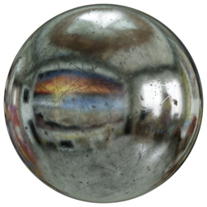</a> <b><a href="Metal001">Metal 001</a></b> by ambientCG · <a href="https://ambientcg.com/a/Metal001">source</a> | <a href="Metal002">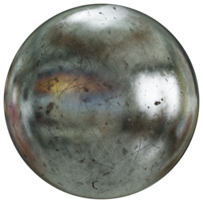</a> <b><a href="Metal002">Metal 002</a></b> by ambientCG · <a href="https://ambientcg.com/a/Metal002">source</a> |  <b><a href="Metal003">Metal 003</a></b> by ambientCG · <a href="https://ambientcg.com/a/Metal003">source</a> | <a href="Metal004">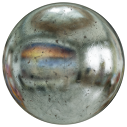</a> <b><a href="Metal004">Metal 004</a></b> by ambientCG · <a href="https://ambientcg.com/a/Metal004">source</a> |
| <a href="Metal005">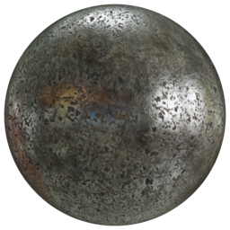</a> <b><a href="Metal005">Metal 005</a></b> by ambientCG · <a href="https://ambientcg.com/a/Metal005">source</a> | <a href="Metal006">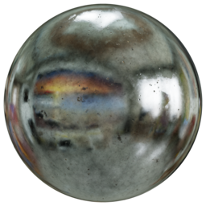</a> <b><a href="Metal006">Metal 006</a></b> by ambientCG · <a href="https://ambientcg.com/a/Metal006">source</a> | <a href="Metal007">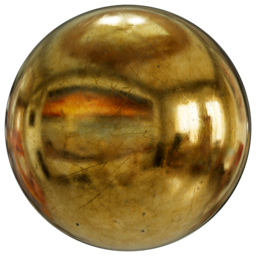</a> <b><a href="Metal007">Metal 007</a></b> by ambientCG · <a href="https://ambientcg.com/a/Metal007">source</a> | <a href="Metal008">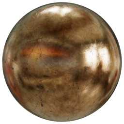</a> <b><a href="Metal008">Metal 008</a></b> by ambientCG · <a href="https://ambientcg.com/a/Metal008">source</a> |
| <a href="Metal009">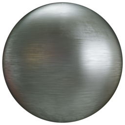</a> <b><a href="Metal009">Metal 009</a></b> by ambientCG · <a href="https://ambientcg.com/a/Metal009">source</a> | <a href="Metal010">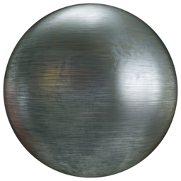</a> <b><a href="Metal010">Metal 010</a></b> by ambientCG · <a href="https://ambientcg.com/a/Metal010">source</a> | <a href="Metal011">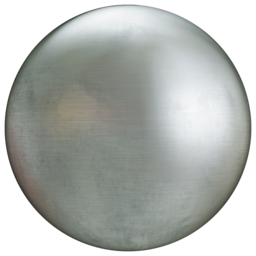</a> <b><a href="Metal011">Metal 011</a></b> by ambientCG · <a href="https://ambientcg.com/a/Metal011">source</a> | <a href="Metal012">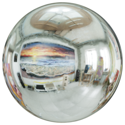</a> <b><a href="Metal012">Metal 012</a></b> by ambientCG · <a href="https://ambientcg.com/a/Metal012">source</a> |
| <a href="Metal013">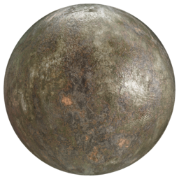</a> <b><a href="Metal013">Metal 013</a></b> by ambientCG · <a href="https://ambientcg.com/a/Metal013">source</a> | <a href="Metal014">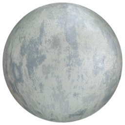</a> <b><a href="Metal014">Metal 014</a></b> by ambientCG · <a href="https://ambientcg.com/a/Metal014">source</a> | <a href="Metal015">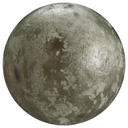</a> <b><a href="Metal015">Metal 015</a></b> by ambientCG · <a href="https://ambientcg.com/a/Metal015">source</a> | <a href="Metal016">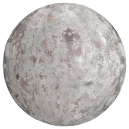</a> <b><a href="Metal016">Metal 016</a></b> by ambientCG · <a href="https://ambientcg.com/a/Metal016">source</a> |
| <a href="Metal017">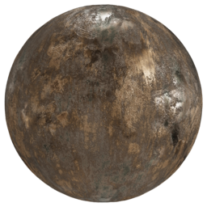</a> <b><a href="Metal017">Metal 017</a></b> by ambientCG · <a href="https://ambientcg.com/a/Metal017">source</a> | <a href="Metal018">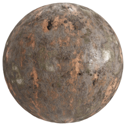</a> <b><a href="Metal018">Metal 018</a></b> by ambientCG · <a href="https://ambientcg.com/a/Metal018">source</a> | <a href="Metal019">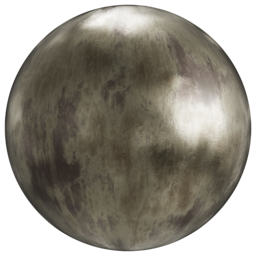</a> <b><a href="Metal019">Metal 019</a></b> by ambientCG · <a href="https://ambientcg.com/a/Metal019">source</a> | <a href="Metal020">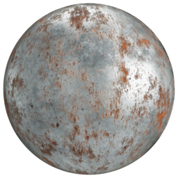</a> <b><a href="Metal020">Metal 020</a></b> by ambientCG · <a href="https://ambientcg.com/a/Metal020">source</a> |
| <a href="Metal021">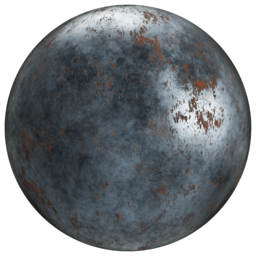</a> <b><a href="Metal021">Metal 021</a></b> by ambientCG · <a href="https://ambientcg.com/a/Metal021">source</a> | <a href="Metal022">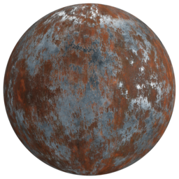</a> <b><a href="Metal022">Metal 022</a></b> by ambientCG · <a href="https://ambientcg.com/a/Metal022">source</a> | <a href="Metal023">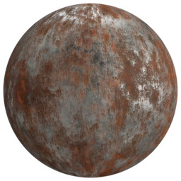</a> <b><a href="Metal023">Metal 023</a></b> by ambientCG · <a href="https://ambientcg.com/a/Metal023">source</a> | <a href="Metal024">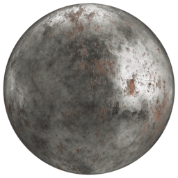</a> <b><a href="Metal024">Metal 024</a></b> by ambientCG · <a href="https://ambientcg.com/a/Metal024">source</a> |
| <a href="Metal025">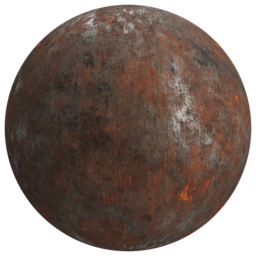</a> <b><a href="Metal025">Metal 025</a></b> by ambientCG · <a href="https://ambientcg.com/a/Metal025">source</a> | <a href="Metal026">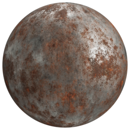</a> <b><a href="Metal026">Metal 026</a></b> by ambientCG · <a href="https://ambientcg.com/a/Metal026">source</a> | <a href="Metal027">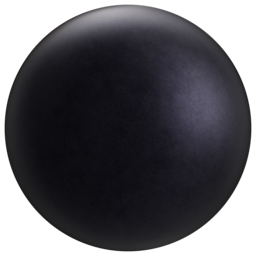</a> <b><a href="Metal027">Metal 027</a></b> by ambientCG · <a href="https://ambientcg.com/a/Metal027">source</a> | <a href="Metal028">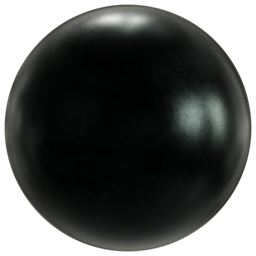</a> <b><a href="Metal028">Metal 028</a></b> by ambientCG · <a href="https://ambientcg.com/a/Metal028">source</a> |
| <a href="Metal029">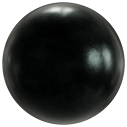</a> <b><a href="Metal029">Metal 029</a></b> by ambientCG · <a href="https://ambientcg.com/a/Metal029">source</a> | <a href="Metal030">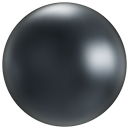</a> <b><a href="Metal030">Metal 030</a></b> by ambientCG · <a href="https://ambientcg.com/a/Metal030">source</a> | <a href="Metal031">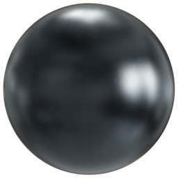</a> <b><a href="Metal031">Metal 031</a></b> by ambientCG · <a href="https://ambientcg.com/a/Metal031">source</a> | <a href="Metal032">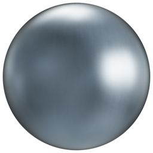</a> <b><a href="Metal032">Metal 032</a></b> by ambientCG · <a href="https://ambientcg.com/a/Metal032">source</a> |
| <a href="Metal033">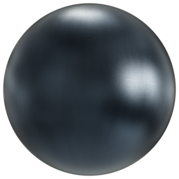</a> <b><a href="Metal033">Metal 033</a></b> by ambientCG · <a href="https://ambientcg.com/a/Metal033">source</a> |  |  |  |

---

Kept up to date by this repository's own [update workflow](.github/workflows/update.yml), with code and plan from [cc0-mirror](https://github.com/zuujis-cc0/cc0-mirror). Something wrong? [Open an issue there](https://github.com/zuujis-cc0/cc0-mirror/issues/new) or use the [private report form](https://games.zuujis.com/report).
